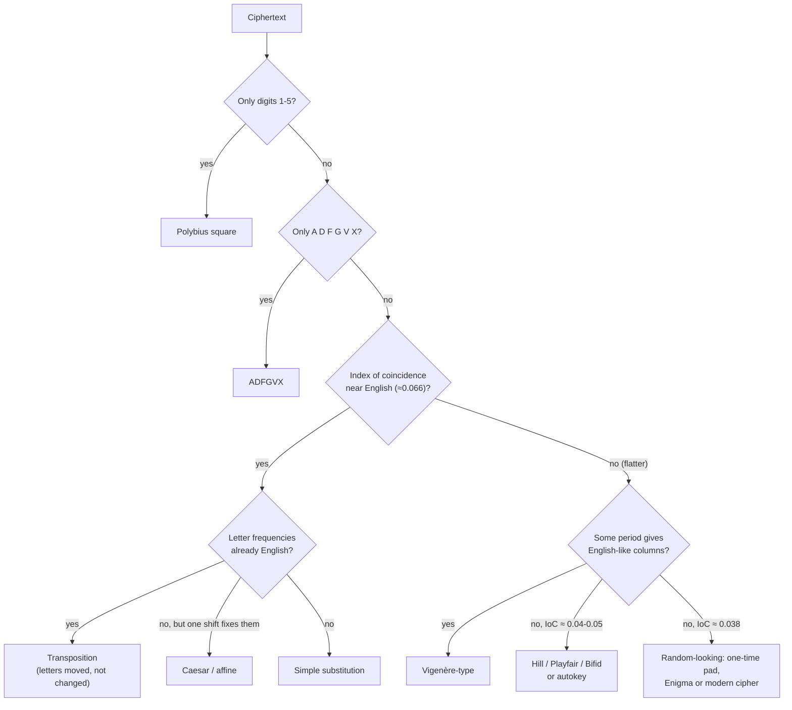

# RP.CodeBreaker: codes, ciphers and how they are broken, explained

> A C# library for making and breaking codes and ciphers, written to be **read and understood**
> before it is used. It is a **tutorial in code**: a guided tour from Caesar's shift to the Enigma
> machine and beyond, aimed at anyone meeting this material for the first time. It assumes nothing
> beyond **school maths** (counting, a little probability, the idea of a logarithm), and its theme
> throughout is **difficulty**: how big each cipher's haystack of keys is, how the code breaker's
> insight and the scraps of information they hold shrink it, and where the line falls between what can
> be broken in a few minutes and what cannot be broken at all.

*This project began with a visit to Bletchley Park. Standing in front of the rebuilt bombe, what struck
me was not the machinery but the reasoning: a few words the code breakers expected to find in a
message turned a problem bigger than the number of grains of sand on Earth into one a room of
whirring drums could finish before lunch. This library tries to make that reasoning something you can
run, measure and change.*

---

## Contents

**Getting started**

- [What this project is for](#what-this-project-is-for)
- [A brief history of Bletchley Park](#a-brief-history-of-bletchley-park)
- [A few words we will use](#a-few-words-we-will-use)

**Step 1: the ideas**

- [Codes and ciphers: converting both ways](#codes-and-ciphers-converting-both-ways)
- [How difficulty is measured](#how-difficulty-is-measured)
- [The difficulty ladder: what falls in a few minutes?](#the-difficulty-ladder-what-falls-in-a-few-minutes)
- [How known information shrinks the search](#how-known-information-shrinks-the-search)
- [When no amount of computing will do: unicity distance](#when-no-amount-of-computing-will-do-unicity-distance)

**Step 2: the code breaker's tools**

- [Teaching a computer what English looks like](#teaching-a-computer-what-english-looks-like)
- [Is the answer right? Checking before believing](#is-the-answer-right-checking-before-believing)
- [The first look: what kind of cipher is it?](#the-first-look-what-kind-of-cipher-is-it)

**Step 3: breaking each cipher**

- [The ciphers, one by one](#the-ciphers-one-by-one)
  - [Caesar, ROT13 and Atbash](#caesar-rot13-and-atbash)
  - [Affine](#affine)
  - [Simple substitution](#simple-substitution)
  - [Polybius square](#polybius-square)
  - [Vigenère, Beaufort and the keyed Vigenère](#vigenère-beaufort-and-the-keyed-vigenère)
  - [Autokey](#autokey)
  - [Rail fence](#rail-fence)
  - [Columnar transposition](#columnar-transposition)
  - [Playfair](#playfair)
  - [Hill](#hill)
  - [Bifid and ADFGVX](#bifid-and-adfgvx)
  - [The one-time pad, and the pad used twice](#the-one-time-pad-and-the-pad-used-twice)
  - [Repeating-key XOR](#repeating-key-xor)
  - [Enigma](#enigma)
- [Breaking Enigma: the bombe](#breaking-enigma-the-bombe)

**Step 4: the limits, and the real thing**

- [Modern cryptography: where the shortcuts run out](#modern-cryptography-where-the-shortcuts-run-out)
- [Famous cases](#famous-cases)

**Step 5: doing it yourself**

- [Breaking a message, step by step](#breaking-a-message-step-by-step)
- [Common situations, and what to do](#common-situations-and-what-to-do)
- [Using the library](#using-the-library)

**Afterwards**

- [Further reading](#further-reading)

---

## What this project is for

Most writing about cryptography falls into two camps. One tells the stories (Mary, Queen of Scots,
the Zimmermann telegram, Bletchley Park) without ever showing how the codes were actually broken.
The other is mathematics for specialists. This library sits between them: every cipher is a small,
readable class, every attack is a short, readable method, and this document explains each one from
the ground up, with the numbers measured by the code rather than quoted from somewhere else.

A few principles run through everything:

- **Difficulty first.** Every cipher has a key space (how many keys there are), every attack returns a
  `Difficulty`, a funnel showing how the search shrank at each step, and the
  `CipherCatalogue` places everything on one ladder, from Caesar to AES, against a line marked "a
  few minutes".
- **No unexplained jargon.** Wherever a term appears, it is introduced in plain language first. If you
  can count, you can follow it.
- **Verbose on purpose.** This document goes into far more detail than a working programmer strictly
  needs. If any part seems patronising, please do not be offended: it is written for a wide audience,
  including people meeting these ideas for the first time.
- **Honest numbers.** The timings and work figures quoted here come from running the library (on one
  core of an ordinary laptop, in Release mode). Where something is an estimate (the cost of factoring
  a 2048-bit number, say) it says so.
- **Clarity over speed.** The attacks are quick enough to break everything they claim to in seconds,
  but they are written to be followed, not to win competitions.

> **A word on purpose.** Everything here is historical or deliberately weak. Breaking a Caesar shift
> or a 1940s Enigma message harms no one, and understanding *why* they fell is the best possible
> education in why modern systems are built the way they are. The [modern
> section](#modern-cryptography-where-the-shortcuts-run-out) shows, with numbers, why the same
> techniques get nowhere against properly-used modern cryptography.

---

## A brief history of Bletchley Park

Bletchley Park is a Victorian country house in Buckinghamshire, about fifty miles north-west of London.
In 1938, with war looking likely, the head of the Secret Intelligence Service, Admiral Sir Hugh
Sinclair, bought it, reportedly with his own money, as a safe home for the Government Code and Cypher
School, Britain's code breakers. They first arrived in September 1938, disguised as "Captain Ridley's shooting
party".

They had a head start they hadn't earned themselves. The Polish Cipher Bureau had been reading Enigma
since 1932, and in July 1939, five weeks before Germany invaded Poland, Marian Rejewski and his
colleagues handed the British and French everything: their methods, their reconstruction of the machine,
and replica Enigmas. When the Germans tightened their procedures and the Polish methods stopped
working, Alan Turing designed a new machine, the **bombe**, that searched for settings using a guessed
word, and Gordon Welchman added the diagonal board that made it fast enough to matter. The first bombe
ran in March 1940. [Breaking Enigma](#breaking-enigma-the-bombe) shows how it worked, step by step.

The work was organised in wooden huts on the lawn: Hut 6 broke Army and Air Force Enigma and Hut 3 turned
the results into intelligence; Hut 8, under Turing, broke the harder Naval Enigma and Hut 4 used it. The
intelligence was code-named **Ultra**. Later, a separate section attacked the German high command's
Lorenz teleprinter cipher ("Tunny"): Bill Tutte worked out how the machine must be built without ever
seeing one, and Tommy Flowers, a Post Office engineer, built **Colossus** to break it: one of the first
electronic computers, working by February 1944 and in time for D-Day.

By 1945 nearly ten thousand people worked there, about three-quarters of them women: the Wrens who ran
the bombes, the operators of Colossus, the clerks and the linguists. All of them kept the secret for
some thirty years, until the story began to come out in the 1970s. The house is now a museum, and The
National Museum of Computing next door has a working rebuilt bombe and Colossus. It was standing in front
of that bombe that started this library.

---

## A few words we will use

- **Plaintext**: the message as written. **Ciphertext**: the message after encryption.
- **Encrypt / decrypt** (or **encipher / decipher**): turn plaintext into ciphertext, and back.
- **Key**: the secret setting that makes your encryption different from everyone else's using the
  same method: the shift of a Caesar cipher, the keyword of a Vigenère, the daily settings of an Enigma.
- **Key space**: the set of all possible keys. Its *size* is the most important number in this
  library: it is the size of the haystack a brute-force search must work through.
- **Brute force**: trying every key until one works. Always possible in principle; the question is
  always *how long*.
- **Bits**: a way of writing big numbers: *n* bits means 2ⁿ. Each extra bit doubles the work. A
  Caesar cipher has 26 keys, about 4.7 bits; AES-128 has 2¹²⁸ keys, exactly 128 bits.
- **Crib**: a piece of plaintext the code breaker believes is in the message, because of its context:
  WETTERBERICHT ("weather report") at the start of a German weather report, DEAR at the start of a
  letter. Bletchley Park slang, now standard.
- **Searcher**: who, or what, is trying keys, and how fast: a clerk with pencil and paper, a wartime
  bombe, a laptop, a graphics card, the whole Bitcoin network (`Attacker`).
- **A few minutes**: five, exactly. The question asked of every cipher here is whether the work left
  fits in five minutes for the chosen searcher.
- **Frequency analysis**: counting letters. English uses E, T and A a lot and Z hardly at all; a cipher
  that keeps that unevenness gives itself away.
- **Index of coincidence**: the chance that two letters picked at random from a text are the same:
  0.066 for English, 0.038 for random letters. It tells you whether a cipher used one alphabet or many.
- **Hill climbing**: start with a random key, change it a little, keep the change if the text reads
  more like English, and repeat. It works when a nearly-right key gives nearly-right text.
- **Quadgram score**: how English a text looks, from how common its runs of four letters (TION, THER...)
  are in real English. The "fitness" every hill climb tries to raise.
- **Unicity distance**: roughly how many letters of ciphertext are needed before only one key gives
  sensible text. Shorter messages can decrypt to several believable answers.
- **Cryptography** is making ciphers; **cryptanalysis** is breaking them. Together they are
  **cryptology**.
- **Code** and **cipher** mean different things: see the next section.

---

## Codes and ciphers: converting both ways

In everyday speech "code" and "cipher" are used interchangeably. To a code breaker they are different
animals, and the difference decides how you attack them.

A **cipher** transforms a message letter by letter (or bit by bit) using a rule and a secret **key**.
Learn the rule and the key and every message opens. Every cipher in this library implements `ICipher`
and is an immutable object built from its key:

```csharp
ICipher caesar = new CaesarCipher(3);
string secret = caesar.Encrypt("Attack at dawn!");   // "Dwwdfn dw gdzq!"
string clear  = caesar.Decrypt(secret);              // "Attack at dawn!"
```

The letter-for-letter ciphers (Caesar, affine, substitution, Vigenère and friends) leave spaces,
punctuation and capitalisation alone so the result still looks like a sentence. Those that work on
blocks or move letters about (transpositions, Playfair, Hill, Enigma) work on the bare letters, in
capitals. `Letters.Normalise("Attack at dawn!")` is `"ATTACKATDAWN"`, and `Letters.Group(...)` writes
it in the traditional blocks of five, `ATTAC KATDA WN`, so that word lengths give nothing away.

A **code** replaces whole symbols, words or phrases with others, using a table. Codes implement
`ICode`, with `Encode` and `Decode`:

| Code | What it does | Example |
|---|---|---|
| `MorseCodeConverter` | Dots and dashes for telegraph and radio | `SOS` -> `... --- ...` |
| `NatoPhoneticCode` | A word for each letter, for crackly voice lines | `BP` -> `BRAVO PAPA` |
| `A1Z26Code` | Letters as their position in the alphabet | `HELLO` -> `8-5-12-12-15` |
| `BaconianCode` | Francis Bacon's 1605 five-symbol A/B code, made for hiding in innocent text | `AB` -> `AAAAA AAAAB` |
| `TapCode` | Row and column taps on a 5×5 grid, used by prisoners of war | `H` -> `..,...` |
| `BinaryCode`, `HexCode`, `Base64Code` | Bytes as bits, hex digits or 64 safe characters | `Hi` -> `SGk=` |
| `Ita2Code` | The 5-bit Baudot-Murray teleprinter code, the code inside every Lorenz (Tunny) message | `HI` -> `10100 00110` |
| `Codebook` | Words and phrases as number groups, in the style of a 1917 diplomatic code | `ATTACK AT DAWN` -> `4071 0005 2216` |

The public codes (Morse, ASCII, Base64) hide nothing; they exist to *carry* text. (Base64 is often
mistaken for encryption. It is not.) Secret codes keep the table private. There is no key to search:
the book *is* the secret, and a code is broken by rebuilding the book from context, one group at a
time, which is exactly how the Admiralty's Room 40 read the Zimmermann telegram in 1917.

For anything that needs to convert generically (a converter screen, a command line), two registries
list everything:

```csharp
foreach (ICode code in CodeCatalogue.All) { ... code.Encode(text) ... }

CipherDefinition def = CipherRegistry.Named("Playfair");   // name, key format, example key
ICipher playfair = def.Create("MONARCHY");                 // build it from a typed key
```

---

## How difficulty is measured

### The key space

Every cipher's difficulty starts with one number: how many keys it could have been set up with. The
library holds it as a `KeySpace`: an exact count (a `BigInteger`, so even 2²⁵⁶ is held exactly), a
description of how it was worked out, and the same number in bits:

```csharp
CaesarCipher.KeySpace          // 26 keys (4.7 bits) - 26 shifts
SubstitutionCipher.KeySpace    // ≈ 4.03 × 10^26 keys (88.4 bits) - 26! orderings of the alphabet
EnigmaMachine.KeySpaceFor()    // ≈ 1.07 × 10^23 keys (76.5 bits) - 60 rotor orders × 26³ start
                               //   positions × 26² ring settings × plugboard with 10 cables
```

Most key spaces are built from two shapes of counting, and it is worth seeing them once:

- **Independent choices multiply.** A five-letter Vigenère key is five choices of 26: 26 × 26 × 26 ×
  26 × 26 = 26⁵ = 11,881,376. `KeySpace.Power(26, 5)`.
- **Orderings are factorials.** A substitution alphabet is one ordering of the 26 letters: 26 choices
  for what A becomes, then 25 left for B, then 24... That is 26 × 25 × 24 × ... × 1, written 26! ("26
  factorial"). `KeySpace.Factorial(26)`.
- **Choices made together multiply again.** `KeySpace.Times(other)`: 60 rotor orders × 17,576 start
  positions.

Factorials outgrow powers astonishingly quickly (26! is about 4 × 10²⁶), and this is the first
lesson of the library: **a big key space is easy to build, and on its own it guarantees nothing.**
Simple substitution has more keys than DES and is solved over breakfast.

> The library computes `log₂(n!)` for very large *n* through the log-gamma function
> (`KeySpace.Log2Factorial`), because ln n! = ln Γ(n + 1). Working with the logarithm keeps the numbers
> small enough to handle: 100! has 158 digits, but log₂(100!) is just under 525.

### From keys to time

A key space becomes a *time* once you know who is searching. An `Attacker` is a name and a rate in
keys per second, and the presets span eighty years of code breaking:

| `Attacker` | Keys per second | Where the figure comes from |
|---|---:|---|
| `PencilAndPaper` | 0.1 | one trial decryption every ten seconds or so |
| `Bombe` | 15 | a Bletchley bombe ran through the 17,576 positions of one wheel order in about 20 minutes |
| `Laptop` | 10⁷ | one core running a cheap trial decryption of a few dozen letters |
| `GraphicsCard` | 10¹⁰ | thousands of cores testing a simple hash or cipher |
| `DeepCrack` | 9 × 10¹⁰ | the EFF's 1998 DES-cracking machine |
| `WholeBitcoinNetwork` | 10²¹ | every Bitcoin miner on Earth, the largest search humanity has ever built |

The arithmetic is simply **time = keys ÷ rate**. `KeySpace.ExhaustiveSearch(attacker)` gives the time
to try every key; `ExpectedSearch` gives half that, since on average you find the key halfway through.
Each answer is a `WorkEstimate`, which describes itself in words and gives a verdict:

```csharp
SubstitutionCipher.KeySpace.ExhaustiveSearch(Attacker.Laptop)
// 1.28 × 10^12 years (92 times the age of the universe) - Feasibility.Infeasible
```

The verdicts (`Feasibility`) are **Instant** (under a second), **FewMinutes** (up to five minutes,
the line this library cares about), **Hours** (up to a day), **Months** (up to a year), **Lifetime**
(up to a century) and **Infeasible**.

### Why the key space is not the difficulty

If the key space were the whole story, simple substitution would be stronger than DES. It is not,
because nobody searches 26! keys one at a time. Each piece of insight a code breaker has (a property
of the language, a property of the cipher, a word they expect) cuts the search, and the real
difficulty is what is left. The library records that story as a `Difficulty`: the starting key
space, then each `Reduction` with what was learned, how many keys remained and why.

Here is the funnel the Vigenère attack produces for the [indéchiffrable example](#famous-cases):

```
Start: every key of 1-12 letters                    ≈ 9.92 × 10^16 keys (56.5 bits)
  -> Key length is 7                                 8,031,810,176 keys (32.9 bits)
  -> Each column is a Caesar cipher                  182 keys (7.5 bits)
```

The last line is the point. Once the key length is known, each of the seven key letters affects only
its own column of the message, so each can be found **on its own** by trying 26 shifts. The work is
not 26⁷ but 7 × 26 = 182. **A product has become a sum.** Most of code breaking, from al-Kindi to
Turing, is finding a way to make that happen: to split one enormous search into many small ones that
can be done separately.

---

## The difficulty ladder: what falls in a few minutes?

`CipherCatalogue.All` puts every cipher in the library (and some modern ones for scale) on one ladder.
For each it gives the full key space, the *effective work* (the number of trials the best attack
actually needs on a message of a few hundred letters) and the time that takes. These are the
library's own figures for one laptop core:

| Cipher | Key space | Effective work | Best attack | Laptop, best attack | Laptop, brute force |
|---|---:|---:|---|---|---|
| Atbash | 0 bits | 0 bits | recognise it | instant | instant |
| Caesar | 4.7 | 4.7 | try all 26 shifts | instant | instant |
| Rail fence | 7.6 | 7.6 | try every rail count | instant | instant |
| Affine | 8.3 | 8.3 | try all 312 keys | instant | instant |
| Hill (2×2) | 17.3 | 10.4 | search each matrix row alone | instant | 16 ms |
| Vigenère (key ≤ 12) | 56.5 | 10.9 | find the period, break each column | instant | 314 years |
| Autokey (primer ≤ 12) | 56.5 | 11.9 | find each primer letter's chain | instant | 314 years |
| Repeating-key XOR (16 bytes) | 128 | 14.0 | Hamming distance, then byte by byte | instant | 10²⁴ years |
| Simple substitution | 88.4 | 14.9 | hill climb on quadgrams | instant | 92 × the age of the universe |
| Polybius square | 83.7 | 14.9 | relabel, then as substitution | instant | 3 × the age of the universe |
| Columnar transposition (8 columns) | 15.3 | 15.3 | try every column order | instant | instant |
| Columnar transposition (15 columns) | 40.3 | 17.6 | hill climb on column moves | 20 ms\* | 36 hours |
| Playfair | 79.0 | ≈ 20 | simulated annealing | 100 ms\* | 2 billion years |
| **Enigma with a crib** | 76.5 | 24.7 | **Turing-Welchman bombe** | **2.7 seconds** | 340 million years |
| ADFGVX | 199 | ≈ 40 | needs several messages on one key | 28 hours\* | beyond counting |
| DES | 56 | 55 | brute force | 114 years | 228 years |
| Enigma *without* a crib | 76.5 | 75.5 | brute force | 170 million years | 340 million years |
| RSA-2048 | n/a | ≈ 117 | number field sieve | 10²⁰ years | n/a |
| AES-128 | 128 | 127 | brute force | 5 × 10²³ years | 10²⁴ years |
| AES-256 | 256 | 255 | brute force | 10⁶² years | 10⁶² years |
| One-time pad | grows with the message | n/a | **none possible** | never | never |

\* The effective-work figures are deliberately round, and the times assume the `Laptop` rate of a *cheap*
trial key. The hill climbs score the whole message for every trial, so in practice a 15-column
transposition or a Playfair grid takes a few seconds, not milliseconds, but still comfortably inside the
line. ADFGVX has no automatic attack here at all; its figure is an estimate of the work a good one would
need.

Three things stand out.

1. **Everything classical falls in a few minutes, and almost everything falls in under a second**,
   despite key spaces up to 88 bits. In every case there is a way to split the search (letters one at a
   time, columns one at a time, rows one at a time) or to climb towards the answer gradually.
2. **Enigma falls in seconds *with a crib* and never without one.** Same machine, same key space; the
   difference is entirely the few words of plaintext the code breakers expected. That one line is the
   story of Bletchley Park. (The 2.7 seconds is not just an estimate from the table: the library's
   bombe searched all 60 rotor orders for the [weather report](#breaking-enigma-the-bombe) in 2.7
   seconds.)
3. **Modern ciphers have no funnel.** For DES and AES the effective work is the key space (less one bit,
   for finding it halfway through on average). They are *designed* so that no insight splits the
   search. DES fell only because 56 bits was too few; AES-128 would outlast the universe even against
   every Bitcoin miner on Earth.

```csharp
foreach (CipherProfile p in CipherCatalogue.BreakableInFewMinutes(Attacker.Laptop))
    Console.WriteLine($"{p.Name}: {p.BestAttack(Attacker.Laptop)}");
```

Change the attacker and the line moves. Against `Attacker.PencilAndPaper`, Vigenère and substitution
take hours of patient work (which is about right historically), and the bombe's search would take a
person longer than a lifetime, which is why Bletchley built machines.

---

## How known information shrinks the search

The ladder above assumes the code breaker knows only the ciphertext and the language. In practice
they nearly always know more, and every scrap shrinks the search. These are the kinds of information
that matter, roughly in order of how often they are available:

### 1. The language itself: always available

The plaintext is (probably) English, or German, or whatever the context says. That alone gives letter
frequencies, common pairs and fours of letters, and a word list. It is what makes "does this decryption
look right?" a question a computer can answer, and it is behind every attack in the library. See
[teaching a computer what English looks like](#teaching-a-computer-what-english-looks-like).

### 2. The kind of cipher: usually deducible

Statistics alone usually say what *kind* of cipher you face (see the
[first look](#the-first-look-what-kind-of-cipher-is-it)), and that alone throws away every other
kind's keys.

### 3. Cribs: words the context suggests

A weather station sends a weather report; an army unit reports "nothing special to report" (KEINE
BESONDEREN EREIGNISSE) every quiet night; a letter starts DEAR; a signal mentions the name of the
place it concerns. Give the attacks those words through `AttackOptions.Cribs` and they use them to
discard keys:

```csharp
var options = new AttackOptions { Cribs = ["BRIDGE"] };
BreakResult r = CaesarAttack.Break(new CaesarCipher(11).Encrypt("Meet me by the old bridge"), options);
```

```
Start: 26 shifts                                    26 keys (4.7 bits)
  -> Plaintext must contain BRIDGE                   1 keys (0.0 bits)
```

For a Caesar cipher that is trivial. For a simple substitution it is a big deal: a crib can only sit
where the ciphertext's letters repeat in the same pattern as the crib's (LETTER is `ABCCBD`: the third
and fourth letters match, and the second matches the fifth). In the Babington example LETTER fits at
only 3 of 369 positions, and once placed it pins its letters in the key:

```
Start: 26! orderings of the alphabet                ≈ 4.03 × 10^26 keys (88.4 bits)
  -> Cribs fix 7 letters of the key                  ≈ 2.43 × 10^17 keys (57.8 bits)
  -> Hill climb: 8 restart(s) × ~642 trial keys      1 keys (0.0 bits)
```

Thirty bits gone from two short words. For Enigma, cribs are not a help but the *whole method*:
without one, the bombe has nothing to reason from.

A crib with no repeated letters is much weaker, because its pattern (`ABCD`) matches almost anywhere:
in a 129-letter test message WAIT fits at 104 of the 126 places it could start. Only one is right, and
a crib placed in the wrong place doesn't just fail to help; it *forces* four wrong letters into the
key, and the climb then dutifully finds the best text it can around them. An early version of the
substitution attack tried only the first six places, which on that message never included the right
one; it returned confident-looking nonsense with WAIT in it. Now `SubstitutionAttack` screens *every*
placement with one quick climb and spends its full search on the three most promising. Long cribs with
repeated letters are still far better: they fit in a handful of places, so there is little to screen.

### 4. Known plaintext: a stretch of message and its ciphertext together

Stronger than a crib, because you know *where* it goes. For the Hill cipher four letters of known
plaintext give the key outright by algebra (`HillAttack.FromKnownPlaintext`). For a one-time pad,
known plaintext reveals that stretch of pad, which is useless, unless the pad was used again.

### 5. Depth: two messages on the same key

The most valuable mistake of all. Two messages enciphered with the same key let the key be cancelled
out entirely. It broke the Lorenz cipher in 1941 (an operator re-sent a long message with the same
settings) and Soviet one-time pads in VENONA. See [the pad used twice](#the-one-time-pad-and-the-pad-used-twice).

### 6. Habits and procedures: the human factor

Enigma operators chose start positions like AAA or keyboard runs like QWE ("cillies"); a ring setting
could be guessed from the first message of the day (the "Herivel tip"); the RAF laid mines in
particular places so that German warnings would contain known place names ("gardening"). None of this
is mathematics, and all of it shrinks the search. The modern equivalent is the [password a person
chose](#passwords-and-pins-the-key-not-the-cipher).

---

## When no amount of computing will do: unicity distance

The ladder answers "how long?". There is a deeper question: is there enough ciphertext for a unique
answer to *exist*?

Take a Caesar cipher of the single letter `K`. All 26 shifts give a letter, and every one is equally
plausible. Two letters (`KH`) still allow several real words (HE, BE, OR...). Somewhere around a
sentence, only one key gives anything readable. Claude Shannon worked out (in 1949) roughly where:

> **unicity distance ≈ key-space bits ÷ redundancy of the language**

**Redundancy** is the part of each letter that is predictable. A letter could carry log₂ 26 ≈ 4.7 bits,
but real English carries only about 1.5 (the rest is spelling, grammar and sense), so English has
about 3.2 bits of redundancy per letter (`KeySpace.EnglishRedundancy`). Each letter of ciphertext gives
the code breaker about 3.2 bits of evidence against wrong keys.

```csharp
CaesarCipher.KeySpace.UnicityDistance()          // ≈ 1.5 letters
SubstitutionCipher.KeySpace.UnicityDistance()    // ≈ 28 letters
EnigmaMachine.KeySpaceFor().UnicityDistance()    // ≈ 24 letters
```

This is the honest boundary on what can be broken:

- **Below the unicity distance, no computer can help.** A 15-letter substitution cipher has many
  readable solutions; choosing between them is guessing.
- **Above it, the answer is unique** and only the work stands in the way: which is where the ladder
  takes over. In practice the attacks here want several times the unicity distance: the hill climbs
  are reliable at a hundred or two letters, not 28.
- **The one-time pad never gets there.** Its key grows with the message, so there are always enough
  keys to explain any ciphertext as any message of the same length. That is Shannon's proof that it is
  unbreakable.

---

## Teaching a computer what English looks like

Every automatic attack needs to answer one question millions of times: *does this decryption look
like English?* `LanguageModel` is the answer, made into numbers. `LanguageModel.English` is counted
from about two million letters of public-domain novels (Conan Doyle, Austen, Dickens, Wells and
Buchan, via Project Gutenberg); `LanguageModel.German` from about a million letters of Goethe, Kafka,
Schiller and Fontane, with umlauts written AE, OE, UE and ß as SS, as Enigma operators keyed them.
The tables are built by `tools/build_language_data.py` and embedded in the assembly.

### Letters

The share of each letter, `LetterFrequencies`. From the English corpus, as percentages:

```
E 12.5  T 9.0  A 8.1  O 7.6  N 7.0  I 6.9  H 6.5  S 6.2  R 5.9  D 4.5  L 3.9  U 2.8  M 2.7
C 2.4  W 2.4  F 2.2  Y 2.1  G 2.0  P 1.6  B 1.5  V 1.0  K 0.8  J 0.1  X 0.1  Q 0.1  Z 0.1
```

Single letters are what a person uses first, and what the chi-squared test and the index of
coincidence measure. But they are a weak judge: "EEETTTAAA" has wonderful letter frequencies.

### Quadgrams

The workhorse is the **quadgram**: a run of four letters. To score a candidate decryption, slide a
four-letter window along it and add up how likely each window is in English. `THER` is the commonest
(log₁₀ probability −2.44); `QZJX` has never been seen and gets the "floor" of −8.30.

Two details matter:

- **Logarithms, added.** The likelihood of a whole text is the *product* of thousands of small
  probabilities, which underflows to zero in a computer. Adding their logarithms gives the same ranking
  without the underflow.
- **A floor, not zero.** A quadgram never seen in the corpus is rare, not impossible. Giving it a tiny
  probability (0.01 occurrences) rather than zero means one unusual name doesn't wreck the score of an
  otherwise perfect decryption.

The beauty of quadgram scoring is that it is **graded**. Correct English scores about −4.3 per window;
the Caesar ciphertext above scores −7.9. And a decryption that is *nearly* right (most letters
correct) scores nearly as well as the right answer. That is what allows a search to *climb* towards
the answer, one small improvement at a time, instead of having to hit it exactly. Every hill climb in
the library depends on it.

```csharp
LanguageModel en = LanguageModel.English;
en.QuadgramScorePerLetter("THE ENEMY IS GATHERING NEAR THE RIVER");   // ≈ -4.3: English
en.QuadgramScorePerLetter("WKH HQHPB LV JDWKHULQJ QHDU WKH ULYHU");   // ≈ -7.9: not
```

`BreakResult.EnglishLikeness` reports this per-window score for every attack, and
`BreakResult.LooksLikeEnglish` is true above −5.1.

### Words

`Words` is the corpus's vocabulary, commonest first, and `Segment` uses it to put the spaces back into
a decryption, choosing the most probable split by dynamic programming:

```csharp
en.Segment("ATTACKATDAWN")   // "ATTACK AT DAWN"
```

It is purely cosmetic, but it makes a result far easier to read.

### Why the language matters

An English model judges a correct German decryption as gibberish. When the bombe below recovered a
German weather report, the plugboard completion only worked once it was given `LanguageModel.German`.
Set `AttackOptions.Language` to match the traffic.

---

## Is the answer right? Checking before believing

Every attack in this library returns its *best* key. The best of a bad lot is still wrong, and an
attack can't tell the difference on its own: a hill climb stuck on a foothill, a crib placed in the
wrong spot, or a message too short to pin the key down all produce text that looks, at a glance, like
an answer. Bletchley Park never believed a bombe stop until it had been tried on a replica Enigma and
the message read. `BreakCheck` is that check, and it asks three blunt questions:

1. **Is every crib in it?** If you were sure the message contained BRIDGE and the answer doesn't, the
   answer is wrong, or the crib is (misspelt, the wrong language, or simply not in this message).
   Nothing else is so decisive, which is one more reason to give cribs.
2. **Does it read?** On the [quadgram score](#quadgrams), real text sits around −4.0 to −4.5 per letter
   and random letters at −6 or lower. Above −4.7 reads clearly; below −5.1 is gibberish; in between is
   the half-readable text of a nearly-right key.
3. **Was there enough of it?** Below the [unicity distance](#when-no-amount-of-computing-will-do-unicity-distance)
   several keys give sensible text, and a hill climb has too little to steer by long before that. Each
   attack has a rough length below which its answer shouldn't be trusted without help:

| Attack | Letters needed, roughly |
|---|---|
| Caesar | 15 |
| Affine | 20 |
| Rail fence | 25 |
| Vigenère, Beaufort | 40 |
| Hill (2 × 2) | 60 |
| Columnar transposition | 60 |
| Autokey | 80 |
| Simple substitution, Polybius | 100 |
| Playfair | 150 |

These are rules of thumb from running the attacks here, not theorems. A crib found in the answer
lowers them a long way (by five letters for each letter of crib, but never below twenty).

The verdict is one of three:

- **Solved**: it reads, it holds every crib, and the message was long enough.
- **Doubtful**: it partly reads, or it reads well but the message is too short to be sure.
- **Failed**: a crib is missing, the text is gibberish, or no key survived.

```csharp
var options = new AttackOptions { Cribs = ["DAWN"] };
BreakResult r = SubstitutionAttack.Break(ciphertext, options);
BreakCheck check = BreakCheck.Check(r, ciphertext, options);
Console.WriteLine($"{check.Confidence}: {check.Summary}");
foreach (string reason in check.Reasons) Console.WriteLine(reason);
```

The check exists because a reader tried exactly that (encrypted a sentence, added a crib, asked for a
break) and got a confident answer that was completely wrong. Running every cipher that way
turned up five separate causes, all now fixed, and each a small lesson:

- **The statistics chose the wrong cipher.** On 49 letters, a rail fence's letter counts look more like a
  substitution's than a transposition's (`CipherIdentifier` said "substitution, 75%" and didn't suggest
  transposition at all). `AutoBreaker` used to stop at the first answer that looked a little English; now
  it stops only on a convincing one, otherwise runs the other quick attacks too, and always prefers an
  answer that contains the cribs.
- **A wrong answer out-scored the right one.** On the same short message enciphered with an affine key,
  the substitution climb found nonsense scoring −4.437 per letter, a whisker better than the true
  affine decryption's −4.453. A substitution has 88 bits of key to bend to fit 49 letters; an affine key
  has 8. So `AutoBreaker` now ranks first by cribs, then by whether the message is long enough to trust
  that attack, and only then by score. Over-fitting is what too many keys and too little text look like.
- **The crib was put in the wrong place**: the substitution placement problem described [under
  cribs](#3-cribs-words-the-context-suggests).
- **The crib was thrown away.** The Hill attack solved cribs only by algebra, which fails when the crib's
  letter pairs don't form an invertible matrix (DAWN's don't). It now uses such a crib row by row
  instead. See [Hill](#hill).
- **Arithmetic that only works with real numbers.** `NumberTheory.MatrixInverse` used Gauss-Jordan
  elimination, the school method, which divides by a "pivot" in each column. Modulo 26 you can't divide by
  13 or by any even number, so a matrix like [[13, 7], [14, 19]], perfectly invertible since its determinant
  19 has an inverse, had no usable pivot and was declared impossible. About one valid Hill key in twenty
  (7,488 of 157,248) was wrongly rejected, and the attack crashed when it met one. The inverse is now worked out from the
  determinant (the adjugate divided by the determinant), which only ever divides by the determinant
  itself. The test suite now checks every one of the 456,976 matrices.

---

## The first look: what kind of cipher is it?

Before any key is guessed, statistics usually reveal what kind of cipher you are facing. The library
gathers the classic measurements in a few static classes.

### Counting letters: `FrequencyAnalysis`

The oldest tool there is, described by the Arab polymath **al-Kindi** in the ninth century. A cipher
that swaps each letter for another (a *monoalphabetic substitution*) changes the letters' names but not
how often they turn up, so the commonest ciphertext letter is probably E.

- `Counts`, `Frequencies`, `Ranked`: the tally, and the table a code breaker writes first.
- `ChiSquared`: Σ (observed − expected)² ÷ expected against English letter frequencies. Zero is a
  perfect match. This breaks a Caesar cipher in one line: try 26 shifts, keep the lowest.
- `ChiSquaredPValue`: the same as a probability, via the chi-squared distribution: near 1 is "very
  English", near 0 is "certainly not plain English letters".
- `Entropy`: bits per letter. Random letters 4.70; English letter frequencies about 4.17.
- `NGrams`: the commonest pairs and triples (TH, HE, IN; THE, AND, ING).
- `FrequencyMatchedKey`: a first-guess substitution key by frequency rank alone.

### The index of coincidence

William Friedman's great discovery (1922). The **index of coincidence** (IoC) is the chance that two
letters picked at random from a text are the same letter:

> IoC = Σ nᵢ(nᵢ − 1) ÷ N(N − 1)

where nᵢ is how often letter *i* appears and N is the total. English is lumpy (lots of E, few Z), so
its IoC is about **0.066** (0.0655 in our corpus; German 0.074). Perfectly random letters give **1/26 ≈
0.0385**. And the key property: **any cipher that only relabels letters leaves the IoC unchanged**,
because the IoC doesn't care which letter is which, only how lumpy the counts are. So:

- IoC near 0.066 -> one alphabet: a substitution, or a transposition (letters merely moved).
- IoC near 0.04 -> many alphabets (Vigenère, Enigma) or none at all (a one-time pad).

### The key length: `Periodicity`

For a Vigenère-type cipher the next question is the length of the key, and there are two classic
methods.

**Kasiski (1863).** When a common word lines up with the same part of the key twice, it encrypts the
same way twice, and the distance between the repeats is a multiple of the key length. `Repeats` finds
them. In the indéchiffrable example (key length 7) they include:

```
RKTFAUTA  105 apart  = 7 × 15
ZLFKFZ     49 apart  = 7 × 7
YXIE       98 and 126 apart = 7 × 14, 7 × 18
UHJ        28 apart  = 7 × 4
GCF        81 apart  - a coincidence (not a multiple of 7)
```

The coincidences are why Kasiski is a *vote* (`KasiskiVotes`), not a proof: 7 collects 13 votes, more
than any other length.

**The index of coincidence by column.** Guess a length L, cut the ciphertext into L columns (every
L-th letter), and measure each column's IoC. With the right L each column is a Caesar cipher of
English and scores like English; with the wrong L the columns are a mixture and score near random.
For the same example:

```
period  2: 0.0506    period  6: 0.0487    period 10: 0.0480
period  3: 0.0490    period  7: 0.0758 <-  period 12: 0.0522
period  4: 0.0516    period  8: 0.0524    period 14: 0.0802  (a multiple of 7)
period  5: 0.0494    period  9: 0.0486
```

Multiples of the true period score just as well (their columns are also single shifts), so
`RankPeriods` prefers the *smallest* period whose IoC is close to the best; otherwise the attack would
cheerfully choose a key twice as long as necessary.

**Friedman's estimate** (`FriedmanEstimate`) gets a length from the overall IoC alone, with no guessing.
It is famously rough, and this example shows why: it says about 2.4 for a key of 7, because this
particular plaintext happens to be lumpier than average English. Use it as a hint and the column test
as the evidence.

### Letter patterns: `WordPatterns`

A substitution cipher changes every letter but cannot change a word's *pattern*: THAT is `ABCA`, and
whatever it encrypts to will have matching first and last letters. `Pattern("WETTERBERICHT")` is
`ABCCBDEBDFGHC`; `Matching("XQPX")` lists the English words that fit; `PlacementsForSubstitution` finds
where a crib can sit. This is how pattern-word dictionaries solve newspaper cryptograms.

### Putting it together: `CipherIdentifier`

`CipherIdentifier.Identify` makes the first look automatic and explains itself:



A Playfair check runs alongside: even length, no J, and no pair that is a double letter is exactly
what Playfair produces. `AutoBreaker.BreakAsync` goes one step further: identify, run the matching
attacks, and return the most trustworthy result. The identification only sets the *order*: on short
messages it can be wrong, so unless an early answer is convincing (the check calls it solved, and a crib
confirms it or it reads very clearly), the other quick attacks run too, and the answers are ranked by
[`BreakCheck.MostTrusted`](#is-the-answer-right-checking-before-believing): cribs first, then whether
the message is long enough for that attack, then the score.

Running "the other attacks too" has a cost, and one attack dominates it: the columnar search, about a
second, far longer than all the others put together. So Auto skips it unless it could possibly be right. A
transposition only moves letters, so its letter counts are exactly the language's: chi-squared per letter
is about 0.1-0.7 for any transposition and 3 or more for anything that changes letters. (The chi-squared
*p-value* won't do here: on a long text it "rejects" genuine English over tiny differences of style.) And
when the quick rail-fence attack has already produced a convincing answer, the columnar search is skipped
altogether.

---

## The ciphers, one by one

Each section follows the same shape: **how it works**, **the key space**, **how it is broken**, **can
it be broken in a few minutes?**, and **in code**. Times are for one laptop core.

### Caesar, ROT13 and Atbash

**How it works.** Shift every letter a fixed number of places along the alphabet, wrapping Z round to
A. With a shift of 3, A -> D, B -> E, X -> A. Treat letters as numbers (A = 0 ... Z = 25) and it is
c = (p + k) mod 26, "mod 26" meaning the remainder after dividing by 26, the arithmetic of a clock with
26 hours. Suetonius tells us Julius Caesar used a shift of 3. **ROT13** is a shift of 13, its own
inverse, used on Usenet to hide punchlines. **Atbash** reverses the alphabet (A becomes Z, Z becomes A) and appears in the
Hebrew Bible.

**Key space.** 26 shifts (Atbash: 1).

**How it is broken.** Try all 26 and keep the one that reads (`CaesarAttack.Break`), or, the way you
would by hand, keep the shift whose letter frequencies best match English
(`CaesarAttack.ShiftByFrequency`).

**A few minutes?** Under a millisecond.

```csharp
BreakResult r = CaesarAttack.Break("Wkh ohjlrqv zloo furvv wkh ulyhu dw iluvw oljkw.");
// r.Key == "shift 3 (A->D)", r.Plaintext == "The legions will cross the river at first light."
```

### Affine

**How it works.** Multiply, then shift: c = (a·p + b) mod 26. Caesar is the case a = 1.

**Key space.** Decryption must undo the multiplication, which needs the *inverse* of a modulo 26: a
number that multiplied by a gives 1 more than a multiple of 26 (3 × 9 = 27, so 9 undoes 3). It exists
only when a shares no factor with 26 = 2 × 13, which leaves 12 multipliers. 12 × 26 = 312 keys.
`NumberTheory.ModInverse` finds inverses with the extended Euclidean algorithm.

**How it is broken / a few minutes?** Try all 312 (`AffineAttack`). Instant.

### Simple substitution

**How it works.** Any rearrangement of the alphabet. `SubstitutionCipher.FromKeyword("ZEBRAS")` uses
the classic keyword alphabet `ZEBRASCDFGHIJKLMNOPQTUVWXY`.

**Key space.** 26! ≈ 4.03 × 10²⁶ (88.4 bits). At ten million keys a second, trying them all would take
92 times the age of the universe.

**How it is broken: hill climbing.** The key isn't a single lock that is either open or shut. A key
with twenty letters right produces text that is *mostly* readable, and the quadgram score shows it. So
`SubstitutionAttack` does what you would do with a pencil:

1. Start from a guess: first the frequency-matched key (commonest ciphertext letter = E, and so on).
2. Swap two letters of the key. If the decryption scores better, keep the swap; if not, undo it.
3. Repeat until no swap helps.

```
score
  ▲                    ╭──╮ the answer
  │        ╭─╮        ╭╯  ╰╮
  │   ╭──╮╭╯ ╰╮  ╭───╯     ╰─╮
  │ ╭─╯  ╰╯   ╰──╯           ╰──     each step: keep a swap only if it climbs
  └──────────────────────────────▶ keys
       ↑ a "foothill": no single swap improves it, but it isn't the answer
```

A climb can stop on a foothill, so the attack **restarts** several times from random keys and keeps the
best. On the 374-letter Babington message it tried 13,333 keys, about one in 3 × 10²² of the key space,
in 69 milliseconds, and read it perfectly. With cribs the letters they pin are never swapped (see
[known information](#3-cribs-words-the-context-suggests)).

**A few minutes?** Well under a second, given a hundred or two letters. Below about 28 letters (the
[unicity distance](#when-no-amount-of-computing-will-do-unicity-distance)) no method can be sure, and
in practice the climb needs about a hundred: on fifty letters it often settles on a key that reads
*almost* well, with a few letters wrong. Short messages get more restarts automatically (they are
cheap), and `BreakCheck` marks the answer doubtful.

### Polybius square

**How it works.** Each letter becomes its row and column in a 5 × 5 grid (I and J share a cell): H in
the plain grid is `23`. Polybius described it for signalling with torches.

**Key space.** 25! grids (83.7 bits).

**How it is broken.** It is a simple substitution wearing digits. Relabel each digit pair as a letter
(11 -> A, 12 -> B...) and hand it to the substitution attack (`PolybiusAttack`). A lovely demonstration that
**changing the symbols adds no security**. Its value is as a building block for Bifid and ADFGVX, which
split the coordinates up.

### Vigenère, Beaufort and the keyed Vigenère

**How it works.** A Caesar shift that changes with every letter, following a repeating keyword. With
the key LEMON, `ATTACKATDAWN` encrypts to `LXFOPVEFRNHR`: the 1st, 6th, 11th... letters are shifted by
L, the 2nd, 7th, 12th... by E, and so on. Described by Giovan Battista Bellaso in 1553 (and named after
Blaise de Vigenère, who described a stronger relative), it was called *le chiffre indéchiffrable* for
three hundred years, because it flattens the letter frequencies that betray a substitution.

- **Beaufort** subtracts instead, c = k − p, so encryption and decryption are the same operation: one
  table or one machine does both, which is why the US Army's M-209 used it.
- **The keyed Vigenère (Quagga)** builds the table on a mixed alphabet. Jim Sanborn's Kryptos sculpture
  at the CIA uses the KRYPTOS alphabet: `new VigenereCipher("PALIMPSEST", "KRYPTOS")` decrypts the
  real K1 panel to BETWEEN SUBTLE SHADING AND THE ABSENCE OF LIGHT LIES THE NUANCE OF IQLUSION (the
  misspelling is Sanborn's).

**Key space.** 26ᴸ for a key of length L; every key up to 12 letters is 9.92 × 10¹⁶ (56.5 bits).

**How it is broken.** Charles Babbage in the 1850s and Friedrich Kasiski in 1863: find the key length
([Kasiski or the IoC](#the-key-length-periodicity)), cut the text into that many columns, and break
each column as a Caesar cipher. `VigenereAttack` does exactly that, then polishes each key letter
against the full-text quadgram score (which rescues short texts where a column has too few letters for
frequencies to be reliable). It is the clearest example of the [product becoming a
sum](#why-the-key-space-is-not-the-difficulty): 26⁷ becomes 7 × 26.

**Crib dragging.** Subtract a known word from the ciphertext and you get the key letters underneath it.
Keys were often words themselves, so sliding a crib along and reading the fragments (`DragCrib`) shows
the right position by eye. With a crib, the attack tries every period and keeps the one where the crib
gives a self-consistent key, enough to break a 42-letter message whose statistics alone say nothing.

**A few minutes?** About 30 milliseconds for the 327-letter example, provided the key length is within
the search. The attack looks at periods up to `AttackOptions.MaxKeyLength` (12 by default). A 13-letter key such as FORTIFICATION is then simply not considered, and the attack
returns the best 12-or-fewer-letter key, which is gibberish; raise the limit and it falls at once.

### Autokey

**How it works.** A short primer starts the key, and then the *message itself* continues it. With
primer QUEEN, `ATTACKATDAWN` is enciphered with the key `QUEENATTACKA`. The key never repeats, so
Kasiski and the column IoC find nothing.

**How it is broken.** Only the primer is secret. With a primer of length L, plaintext letter i + L is
decrypted using plaintext letter i, so primer letter *j* alone decides plaintext letters j, j + L,
j + 2L... form a chain. Each chain can be scored on its own by letter frequencies, so an L-letter primer costs
26 × L trials. `AutokeyAttack` tries each length and keeps the best. The same "make it a sum" trick as
Vigenère, reached by a different road. Instant.

### Rail fence

**How it works.** Write the message in a zigzag across a number of rails and read each rail off. With
three rails `WE ARE DISCOVERED FLEE AT ONCE` becomes `WECRLTEERDSOEEFEAOCAIVDEN`. A
**transposition**: letters are moved, not changed, so the letter frequencies are exactly English,
which is how you recognise one.

**How it is broken.** The key is one small number; try them all (`RailFenceAttack`). Instant.

### Columnar transposition

**How it works.** Write the message in rows under a keyword and read the columns off in the keyword's
alphabetical order. ZEBRAS reads the column under A first, then B, E, R, S and Z
(`OrderFromKeyword("ZEBRAS")` is `[4, 2, 1, 3, 5, 0]`). The last row is left short when the message
doesn't fill it, which is harder to attack than padding.

**Key space.** k! orders for k columns: 720 for six, 40,320 for eight, 1.3 × 10¹² for fifteen.

**How it is broken.** `ColumnarAttack` tries every order for up to eight columns. Beyond that it hill
climbs, with two kinds of move: swapping two columns, and lifting one column out and putting it
somewhere else (so a run of columns already in the right order can slide into place together), and
an **iterated local search**: when the climb stops, it "kicks" the best order (a couple of random
changes) and climbs again, keeping the kick only if it leads higher. Plain restarts throw away a nearly
right order; kicks keep most of it. A sixteen-column key falls in a few seconds.

**A few minutes?** Yes, for keys into the teens. Double transposition (two in a row, as SOE agents used)
is far harder and not attempted here.

### Playfair

**How it works.** Encrypt *pairs* of letters using a 5 × 5 keyword grid (Charles Wheatstone, 1854,
promoted by Lord Playfair; used in the Boer War, the First World War, and by Australian coastwatchers in
the Second). For each pair: same row -> take the letters to the right; same column -> take the letters
below; otherwise the pair marks opposite corners of a rectangle, so take the other two corners.
Doubled letters are split with an X (BALLOON -> BA LX LO ON).

**Key space.** 25! grids, but each grid can be rotated through its rows and columns without changing the
cipher, so 24! ≈ 6.2 × 10²³ (79 bits).

**How it is broken: simulated annealing.** Playfair's landscape is rougher than a substitution's:
swapping two letters in the grid changes every pair that touches either of them, and a nearly right
grid can still produce nonsense. A hill climb gets stuck almost every time. `PlayfairAttack` uses
**simulated annealing**, borrowed from metalwork: a hill climb that is sometimes allowed to step
*downhill*. A change that worsens the score by d is accepted with probability e^(−d/T), where T is a
"temperature" that falls steadily. Hot, the search roams widely and can escape dead ends; cool, it
settles into the deepest valley it has found. Moves are those that suit a grid: mostly swapping two
letters, sometimes swapping rows or columns or reversing the grid.

**A few minutes?** Yes, but this is the hardest classical cipher in the library. On a 327-letter
message it needs roughly 0.5-1.5 million trial grids (a few seconds), and some runs still end in a dead
end, which is why it restarts. Short messages (the 100-letter PT-109 example) are much harder.

### Hill

**How it works.** Lester Hill, 1929: treat each block of n letters as a column of numbers and multiply
it by an n × n key matrix, modulo 26. With key [[3, 3], [2, 5]], HE = (7, 4) becomes (3·7 + 3·4,
2·7 + 5·4) = (33, 34) ≡ (7, 8) = HI. Decryption multiplies by the inverse matrix modulo 26
(`NumberTheory.MatrixInverse`), which exists only when the determinant shares no factor with 26.

**Key space.** Of the 26⁴ = 456,976 possible 2 × 2 matrices only 157,248 are invertible (17.3 bits).
(The test suite checks that figure by counting.)

**How it is broken.** Two ways, both short:

- **Known plaintext: algebra.** C = K·P, so K = C·P⁻¹. Four letters of crib give a 2 × 2 key outright
  (`HillAttack.FromKnownPlaintext`). Being *linear* is the Hill cipher's downfall.
- **Ciphertext only: one row at a time.** In P = D·C, the first row of the decryption matrix D makes
  the first letter of every pair and nothing else. So each row is found separately by trying its 26² =
  676 values and asking which gives English letter frequencies; then the best rows are paired up and
  scored on quadgrams. 2 × 676 = 1,352 trials, not 157,248: the product-into-sum trick once more.
- **A crib the algebra can't use: row by row.** The algebra needs the crib's letter pairs to form an
  invertible matrix, and often they don't: DAWN's pairs (D, A) and (W, N) give a determinant of 13,
  which has no inverse modulo 26. But each row of D must still turn the ciphertext under the crib into
  the crib's letters, so at each place the crib could sit, keep only the rows that do. On a 49-letter
  message that left 13 candidates for each row, 144 valid matrices across every placement, and the
  right one read at once, where the frequency method, with so few letters, had nothing to go on.

Instant either way.

### Bifid and ADFGVX

These two are here to show where the automatic methods stop.

**Bifid** (Félix Delastelle, 1895) writes each letter's row and column from a Polybius grid one above
the other, reads the digits off row-wise in blocks, and turns them back into letters. Each ciphertext
letter then depends on *two* plaintext letters (*fractionation*), which smears the statistics far more
than a substitution.

**ADFGVX** (Fritz Nebel, German army, 1918) puts letters and digits in a 6 × 6 square labelled A D F G V
X (letters chosen because they sound unlike in Morse), then scrambles the resulting letter pairs with a
columnar transposition. Substitution *and* transposition, so each ciphertext letter is half a symbol,
moved away from its partner, and no single statistic gives a hill to climb.

Both can be made and decrypted here (`BifidCipher`, `AdfgvxCipher`) but neither has an automatic attack.
Georges Painvin broke ADFGVX in June 1918 by finding two messages with similar beginnings on the same
key ([depth](#5-depth-two-messages-on-the-same-key) again), at a cost of days of work and much of his
health. The catalogue estimates the ciphertext-only work at around 2⁴⁰: a day or more for a laptop with
a good method, and a good method is a research project.

### The one-time pad, and the pad used twice

**How it works.** A Vigenère cipher whose key is truly random letters, as long as the message, and
never used again (`OneTimePad.Generate` uses a cryptographic random generator).

**Key space.** 26ⁿ for an n-letter message and, uniquely, **no way to tell the right key from the
wrong ones**. Every plaintext of the right length is produced by some pad, so trying keys gives you
every possible message and no reason to prefer one. Shannon proved it in 1949: the one-time pad is
perfectly secure. Its unicity distance is never reached.

**Unless it is used twice.** If c₁ = p₁ + k and c₂ = p₂ + k with the same pad k, then c₁ − c₂ = p₁ − p₂.
The pad has vanished; what is left is two English texts tangled together. Guess a word in one
(a crib), subtract it, and the other message's letters at that position fall out: English if the guess
was right, gibberish if not. `TwoTimePadAttack.DragCrib` slides the crib along and ranks the
positions. This is how **VENONA** worked: Soviet pads duplicated under wartime pressure were read for
decades.

### Repeating-key XOR

**How it works.** The computer-age Vigenère: combine each byte with the next byte of a short repeating
key using exclusive-or (XOR, "one or the other but not both"). XOR undoes itself, so the same operation
decrypts.

**How it is broken.** Exactly as Vigenère, moved from letters to bytes (`XorAttack`). The key length is
found by **Hamming distance**: XOR two blocks one key-length apart and the key cancels, leaving
plaintext ⊕ plaintext, which differs in fewer bits than random bytes do. Then every L-th byte shares a
key byte, found by trying all 256 and keeping the one that produces the most English-like characters.
Multiples of the key length look just as good on Hamming distance, so the attack prefers the shortest
key whose decryption scores within a whisker of the best. Instant: `"SECRET"` falls in 13 ms.

### Enigma

**How it works.** The German Enigma machine (`EnigmaMachine`, the army and air force's three-rotor
Enigma I). Pressing a key sends a current through:

```
key -> plugboard -> right rotor -> middle -> left -> reflector
                                                         |
lamp <- plugboard <- right rotor <- middle <- left <-----+
```

- **Rotors** (`EnigmaRotor.I` ... `VIII`, with their historical wirings): discs of 26 contacts each side,
  wired in a scrambled order. The right rotor steps on **every** key press, so every letter is
  enciphered by a different alphabet.
- **Stepping**: when the right rotor passes its notch it kicks the middle rotor on; when the middle rotor
  reaches its own notch, it moves again on the next press *and takes the left rotor with it*: the
  famous **double step**. From ADU the windows read ADV, AEW, BFX (`PositionsAfter` shows it; the test
  suite checks it).
- **Ring settings** turn the alphabet ring relative to the wiring, which changes when the notch acts.
- **The reflector** (`EnigmaReflector.B`) sends the current back by a different path. It makes the
  machine its own inverse (the same settings decrypt), and it means **no letter ever encrypts to
  itself**. That small flaw is at the heart of everything below.
- **The plugboard** (Steckerbrett) swaps letters in pairs before and after the rotors.

```csharp
var settings = EnigmaSettings.Parse("I II III", "B", rings: "AAA", positions: "AAA");
new EnigmaMachine(settings).Encrypt("AAAAA");   // "BDZGO" - the standard test vector
```

**Key space.** `EnigmaMachine.KeySpaceFor()` multiplies it out:

| Part | Choices |
|---|---:|
| Rotor order: 3 of 5 rotors, in order | 60 |
| Start positions | 26³ = 17,576 |
| Ring settings (the left ring changes nothing a start position couldn't) | 26² = 676 |
| Plugboard, 10 cables: 26! ÷ (6! · 10! · 2¹⁰) | 150,738,274,937,250 |
| **Total** | **≈ 1.07 × 10²³ (76.5 bits)** |

The navy's eight-rotor version (`KeySpaceFor(8)`) has 336 rotor orders, ≈ 6 × 10²³. Notice where the
size lives: **almost all of it is the plugboard**. The rotors and positions are "only" about a million
combinations. That observation is where the attack begins.

---

## Breaking Enigma: the bombe

The Polish Cipher Bureau (Marian Rejewski, Jerzy Różycki and Henryk Zygalski) broke Enigma first, in
1932, and in July 1939 handed everything they knew to the British and French. When the Germans tightened
their procedures, Alan Turing designed a new machine around a different idea, and Gordon Welchman made
it decisive. The British bombe (named in honour of the Polish *bomba*) went into service in 1940; by the
end of the war over two hundred were running.

`EnigmaBombe` is that machine, in software.

### Step 1: place the crib

You need a crib: plaintext you are confident is in the message, and roughly where. German weather
stations sent reports every morning beginning WETTERBERICHT. Because **Enigma never encrypts a letter to
itself**, the crib can only sit where none of its letters lies over the same ciphertext letter:

```
ciphertext  M I C I D E T T U B T S W I K V ...
crib        W E T T E R B E R I C H T          <- no letter matches: possible
```

`PossibleCribPositions` applies the rule. For the [weather report example](#famous-cases) it rules out
28 of the 82 places the crib could go, leaving 54.

### Step 2: build the menu

Lay the crib against the ciphertext and read it as a graph: each crib letter is joined to the
ciphertext letter under it, labelled with its position. `BuildMenu` does this and counts its **loops**:
chains of letters that come back to where they started:

```
W-M(0)  E-I(1)  T-C(2)  T-I(3)  E-D(4)  R-E(5)  B-T(6)  E-T(7)  R-U(8)  I-B(9)  C-T(10)  H-S(11)  T-W(12)
```

Drawn as a graph:

```
              M
              │ 0
              W
              │ 12
    C ══ 2,10 ══ T ─── 6 ─── B
                ╱ ╲          │
             7 ╱   ╲ 3       │ 9
              ╱     ╲        │
             E ── 1 ── I ────┘
            ╱ ╲
         5 ╱   ╲ 4
          R     D                H ── 11 ── S
          │ 8
          U
```

There are three **loops**, chains of links that come back to where they started: E-I-T (positions 1,
3, 7), T-C-T (2 and 10, the same two letters linked twice) and T-B-I-T (6, 9, 3). **Loops are what make
the bombe work**, as the next step shows. This menu has 12 letters and 3 loops.

### Step 3: reason instead of searching

Write S for the plugboard and Eᵢ for the rotors and reflector at crib position *i*. A crib letter p
enciphering to c at position *i* means c = S(Eᵢ(S(p))), and because the plugboard swaps in pairs,
that is S(c) = Eᵢ(S(p)).

Now **suppose** the plugboard partner of the commonest menu letter, T. Say S(T) = A. Every link touching
T now *tells you* another partner: T-C at position 2 says S(C) = E₂(A). That tells you more, and so on
around the menu. If the guess was wrong, the chain soon demands that some letter has two different
partners (a **contradiction**) and the guess dies. Try all 26 guesses for S(T). If every one
contradicts itself, **this rotor position is impossible, for every one of the 150 million million
plugboard settings at once**. The loops make the contradictions come fast.

Welchman's **diagonal board** added the observation that plugging is symmetric: if S(T) = A then S(A) =
T. That doubles the deductions and slashes the false stops. `EnigmaBombe.Deduce` applies it on every
step.

So the bombe never searches the plugboard at all. It searches only rotor orders and positions, and
because it tests the rotors' *cores*, the ring settings drop out too:

```
Start: 60 rotor orders × 26³ × 26² × plugboard        ≈ 1.07 × 10^23 keys (76.5 bits)
  -> Plugboard handled by deduction, rings drop out     1,054,560 keys (20.0 bits)
  -> Bombe stops                                        1 keys
  -> Checking machine                                   1 keys
```

Fifty-six bits removed by logic.

### Step 4: the checking machine

Where some guess survives, the bombe **stops**. A stop is a candidate rotor order and position, plus the
plug pairs the surviving guess implied. Bletchley's checkers then tried it on a real Enigma. The software
version tries the 26 settings of the right-hand ring (which decide when the middle rotor steps), keeps
one under which the whole crib enciphers correctly, and completes the plugboard by hill climbing, adding
whichever remaining cable makes the full decryption most like the language.

### The result

```csharp
FamousCase c = FamousCases.WeatherReport;
BombeResult r = await EnigmaBombe.RunAsync(c.Ciphertext, "WETTERBERICHT", position: 0,
    options: new AttackOptions { Language = LanguageModel.German });
```

The library's own run, all five rotors:

```
No letter enciphers to itself: the crib WETTERBERICHT can sit at 54 of 82 positions.
Menu WETTERBERICHT over MICIDETTUBTSW at 0: 12 letters, 3 loop(s), test letter T.
1 stop(s) from 1,054,560 rotor positions.
Stop II IV I at FEW: AT BS DE FM IR OW checks out with right ring F, start FEA

II IV I / UKW-B / rings AAF / start FEA / plugs AT BS DE FM IR KN LZ OW PV XY
WETTERBERICHTFUERDIENORDSEEXWINDAUSWESTSUEDWESTSTAERKEFUENFXSICHTGUTXREGENSCHAUERAMNACHMITTAGX
```

*Wetterbericht für die Nordsee: Wind aus Westsüdwest, Stärke fünf; Sicht gut; Regenschauer am
Nachmittag.* A million rotor positions, one stop, 2.7 seconds. The bombe found six of the ten cables by
pure deduction; the checker found the other four.

### What can go wrong, and did

- **Few loops, many stops.** Without loops, a wrong guess can only be caught by the symmetry of the
  plugboard, so many survive. The same weather report started from DQX instead of FEA gives a menu with
  *no* loops: 56 stops instead of one, each of which the checker must work through (it still finds the
  answer, in a second). Shorter and loop-free is hopeless: the half-crib WETTER on its own made 130,004
  stops from 105,456 positions: more stops than positions, because several guesses survive at once.
  Bletchley's menu-makers chose cribs and positions for their loops, and so should you; the bombe logs a
  warning when a menu has none.
- **The middle rotor turning mid-crib.** The bombe assumes the middle rotor stays put while the crib is
  being enciphered. With a 13-letter crib that fails about half the time. If no stop survives checking,
  the library reruns each half of the crib separately (a crib shorter than 26 letters can contain at most
  one turnover, so one half is always clean), but only halves with loops are worth running.
- **A wrong crib.** If WETTERBERICHT isn't where you put it, nothing checks out. Try the next possible
  position.

### Why it worked, and why it wouldn't now

Notice what the bombe exploited: a **property of the machine** (no letter to itself; plugging is
symmetric) and a **habit of the users** (routine messages in routine words). Neither is a matter of key
size. Enigma's 76 bits were never brute-forced; they were *reasoned around*. Modern ciphers are designed
so that no such reasoning exists, and modern procedures (random padding, no fixed formats) deny the cribs.

---

## Modern cryptography: where the shortcuts run out

Every classical attack above works by **splitting** the search (letters, columns, rows or rotor
positions found one at a time) or by **climbing** towards the answer because partly-right keys give
partly-right text. Modern ciphers are designed so that neither is possible: change one bit of the key
and every bit of the output changes, unpredictably, so a key that is 99% right decrypts to pure noise.
Then the key space *is* the work, and the only question is whether it is big enough.

### DES and AES: the key space is the work

DES (1977) had 56-bit keys: 7 × 10¹⁶. In 1998 the EFF's Deep Crack, built for $250,000, found a DES key
in 56 hours (`Attacker.DeepCrack`: the whole space in about nine days). That was the end of DES.

AES-128 has 2¹²⁸ ≈ 3.4 × 10³⁸ keys. At the rate of every Bitcoin miner on Earth combined,
`KeySpace.FromBits(128).ExhaustiveSearch(Attacker.WholeBitcoinNetwork)` is about ten billion years,
most of the age of the universe, for one key. AES-256 squares that. (A large quantum computer running
Grover's algorithm would, in principle, halve the bits: AES-256 would still be 128-bit strong.)

### RSA: the difficulty is factoring

`ToyRsa` is textbook RSA with deliberately small keys. Pick two primes p and q, publish n = p·q; anyone
can encrypt, but decrypting needs a number computed from p and q. So **the private key is exactly as safe
as n is hard to factor**, and `Factoring` shows how that difficulty grows:

| Method | Work for an n of b bits | 64-bit n | 100-bit n | 2048-bit n |
|---|---|---|---|---|
| `TrialDivision` (try every divisor up to √n) | 2^(b/2) | instant | years | never |
| `PollardRho` (a random walk that collides after about √p steps) | 2^(b/4) | instant | seconds | never |
| `Fermat` (only when p and q are close together) | tiny | instant | instant | instant, if the key is badly made |
| Number field sieve (the record-holder; estimate only) | ≈ e^(1.92 (ln n)^⅓ (ln ln n)^⅔) | n/a | n/a | ≈ 2¹¹⁷ |

An 80-bit modulus falls to Pollard's rho in about half a second (788,607 steps). The record factorisations
used the number field sieve: RSA-129 in 1994 ("The Magic Words are Squeamish Ossifrage"), the 512-bit
RSA-155 in 1999. `Factoring.EstimateNumberFieldSieveOperations(2048)` gives about 2¹¹⁷, the reason
2048-bit keys are used today. Fermat's method is here as a cautionary tale: keys generated with p and q
too close together have been found in real devices, and fall instantly.

### Passwords and PINs: the key, not the cipher

`PasswordCracking` makes the most important point in modern code breaking. SHA-256 is unbroken: 2²⁵⁶
possible outputs, no known shortcut. And it does not save a four-digit PIN:

```csharp
CrackResult pin = PasswordCracking.CrackPin(PasswordCracking.Sha256Hex("4071"), digits: 4);
// "4071", after 4,072 guesses, in 2 milliseconds
```

The work is not the size of the hash; it is the size of the set **the secret was chosen from**. 10,000
PINs. A few thousand common words with a capital letter and a digit or two on the end
(`CrackWord`): five thousand words, three capitalisations and a hundred and two endings is about one and
a half million guesses: a fraction of a second. This is the modern crib. Knowing
how *people* choose keys shrinks the search exactly as knowing a message says WETTERBERICHT did, and it
is why real systems use slow, salted password hashes (bcrypt, scrypt, Argon2) and limit guesses.

---

## Famous cases

`FamousCases.All` holds a message for each of these, to break with the library.
Where the historical ciphertext is public and short (Kryptos K1) it is used as it stands; otherwise the
message is new text in the spirit of the original, enciphered here, so it can be broken with the same
method that broke the real thing.

| Case | When | Cipher | How it fell | In the library |
|---|---|---|---|---|
| **Caesar's dispatch** | c. 55 BC | Caesar shift 3 | Try all 26 | `CaesarAttack`, instant |
| **Mary, Queen of Scots**: the Babington plot | 1586 | Nomenclator (substitution) | Thomas Phelippes, by letter frequencies; Mary was executed | `SubstitutionAttack`, 69 ms |
| **Le chiffre indéchiffrable** | 1553-1863 | Vigenère | Babbage and Kasiski: find the period | `VigenereAttack`, 32 ms |
| **The radiogram of victory** | 1918 | ADFGVX | Painvin, from two messages on one key | encode/decode only |
| **The Zimmermann telegram** | 1917 | Diplomatic codebook | Room 40 rebuilt the book from context | `Codebook` |
| **WETTERBERICHT** | 1940-45 | Enigma | The bombe, with a crib | `EnigmaBombe`, 0.6 s (rotors I, II, IV) / 2.7 s (all five) |
| **PT-109** | 1943 | Playfair | (sent, not broken; field-grade security) | `PlayfairAttack`, hard: only 100 letters |
| **VENONA** | 1943-80 | One-time pad, reused | Crib dragging across messages in depth | `TwoTimePadAttack` |
| **Kryptos K1** (real ciphertext) | 1990 | Keyed Vigenère | James Gillogly, 1999 (NSA in 1992) | `VigenereCipher("PALIMPSEST", "KRYPTOS")` |
| **Home-made XOR** | today | Repeating-key XOR | Hamming distance, then byte by byte | `XorAttack`, 13 ms |

A few more that the library tells the story of without a message to break:

- **Lorenz (Tunny) and Colossus.** Hitler's high command used the Lorenz SZ40/42 teleprinter cipher,
  which added a stream of pseudo-random bits to each 5-bit ITA2 character (`Ita2Code` is that code). On 30
  August 1941 an operator re-sent a 4,000-character message with the same settings: depth. John Tiltman
  recovered the key stream; Bill Tutte deduced the entire machine from it without ever seeing one; and
  Tommy Flowers built Colossus, the first programmable electronic computer, to find the wheel settings.
- **The Zodiac Killer's ciphers** (1969-70) used *homophonic* substitution: several symbols per common
  letter, to flatten the frequencies. The 408-symbol cipher was solved by hand in a week; the
  340-symbol one held out until 2020, when a team broke it with a modern solver.
- **Naval Enigma** added rotors VI-VIII, then a fourth rotor in February 1942, blacking out U-boat traffic
  for ten months until captured material and cribs reopened it.

---

## Breaking a message, step by step

Everything above, boiled down to a routine: the order I go in when someone hands me a message and I know
nothing about it. Each step links back to where it is explained properly.

1. **Gather what you know before you look at the letters.** Who sent it, to whom, when, in what
   language, and what is it likely to say? A weather station sends weather reports; a letter starts
   DEAR. Every word you can guess is a [crib](#3-cribs-words-the-context-suggests), and a crib is
   worth more than any amount of computing.
2. **Clean it up and count it.** `Letters.Normalise` strips it to bare capitals. Note the length: below
   the [unicity distance](#when-no-amount-of-computing-will-do-unicity-distance) no method can promise a
   unique answer, and each attack has [a length below which it shouldn't be trusted](#is-the-answer-right-checking-before-believing).
3. **Take the first look.** Is it only digits 1-5, or only ADFGVX? What is the index of coincidence:
   one alphabet (about 0.066) or many (nearer 0.04)? Do the letter counts already match English, so the
   letters have only been moved? `CipherIdentifier.Identify` asks all of these and gives its reasons. See
   [the first look](#the-first-look-what-kind-of-cipher-is-it).
4. **If it uses many alphabets, find the key length.** `Periodicity.RankPeriods` cuts the text into
   columns for each guess and measures them; Kasiski's repeats vote alongside. See
   [the key length](#the-key-length-periodicity).
5. **Choose the attack.** Each cipher's section says how it is broken. If you are unsure, let
   `AutoBreaker.BreakAsync` try the likely ones in turn and rank what they find.
6. **Check the answer before you believe it.** `BreakCheck.Check` asks whether every crib is there,
   whether it reads, and whether the message was long enough. Only *Solved* means solved.
7. **If it failed, change one thing at a time.** Add or correct a crib, raise `Restarts`, try another
   `Seed` (the climbs are randomised), raise `MaxKeyLength`, or try a different family of cipher. The
   [common situations](#common-situations-and-what-to-do) below go through the usual cases.
8. **Read the funnel.** The `Difficulty` that comes back with every answer shows how big the haystack
   started, how much each insight removed, and how much work was left. That is the whole point of this library.

In code, the same eight steps:

```csharp
using RP.CodeBreaker;
using RP.CodeBreaker.Attacks;

// 1. What we know: the context says it probably mentions the harbour.
var options = new AttackOptions { Cribs = ["HARBOUR"] };

// 2. Clean it up and count it.
string letters = Letters.Normalise(ciphertext);
Console.WriteLine($"{letters.Length} letters");

// 3. The first look.
Console.WriteLine($"IoC {FrequencyAnalysis.IndexOfCoincidence(letters):F4}");
foreach (CipherGuess g in CipherIdentifier.Identify(letters))
    Console.WriteLine($"{g.Family} ({g.Confidence:P0}): {g.Reason}");

// 4. If it looks like many alphabets, the likely key lengths.
foreach (PeriodCandidate p in Periodicity.RankPeriods(letters).Take(3))
    Console.WriteLine($"period {p.Period}: IoC {p.AverageIoC:F4}, {p.KasiskiVotes} Kasiski votes");

// 5. Break it - here, letting the library choose the attack.
var (guesses, best, all) = await AutoBreaker.BreakAsync(ciphertext, options);

// 6. Check it.
BreakCheck check = BreakCheck.Check(best!, ciphertext, options);
Console.WriteLine($"{check.Confidence}: {check.Summary}");

// 8. How hard was it, really?
Console.WriteLine(best!.Difficulty);
```

---

## Common situations, and what to do

**"I have a ciphertext and nothing else."** Run `CipherIdentifier.Identify` and read its reasons, or let
`AutoBreaker.BreakAsync` choose and run the attack. Check the length against the [unicity
distance](#when-no-amount-of-computing-will-do-unicity-distance): if you have fewer than a few dozen
letters, expect several plausible answers.

**"I think I know a word in it."** Put it in `AttackOptions.Cribs`. Every attack uses cribs to discard
keys; for Vigenère and Hill a crib can solve messages the statistics can't; for Enigma it is essential.
Choose long cribs with repeated letters; they fit in fewer places.

**"I have two messages that might share a key."** That is depth, the strongest position there is.
Subtract them (`TwoTimePadAttack.DragCrib`) and drag likely words.

**"It's short."** Short texts starve frequency analysis. Lean on cribs, raise `Restarts`, and accept that
below the unicity distance the answer may not be unique. `BreakCheck` says how many letters each attack
usually needs; below that, treat any answer as a guess.

**"It isn't English."** Set `AttackOptions.Language` (English and German are built in; another language
needs its own tables from `tools/build_language_data.py`).

**"The attack returned rubbish."** Run `BreakCheck.Check` on it, and look at `BreakResult.Log`. A missing
crib or a score below about −5.1 per letter means the attack has not found the answer: try a different
cipher family, a larger `MaxKeyLength`, more `Restarts` (the climbs are randomised; another `Seed` may
succeed), or a crib.

**"It returned something plausible, but I'm not sure."** That is what `Doubtful` is for. Check the
length against the table in [checking the answer](#is-the-answer-right-checking-before-believing), and
add a crib: a wrong key almost never produces your crib by accident.

**"It's a modern cipher."** Don't attack the cipher. Attack the key: how was it chosen, and from how
large a set? That is where real systems fail.


---

## Using the library

```csharp
using RP.CodeBreaker;
using RP.CodeBreaker.Attacks;
using RP.CodeBreaker.Ciphers;

// Make some ciphertext.
string secret = new VigenereCipher("WINTER").Encrypt("It was the best of times, it was the worst of times...");

// What is it?
foreach (CipherGuess g in CipherIdentifier.Identify(secret))
    Console.WriteLine($"{g.Family} ({g.Confidence:P0}): {g.Reason}");

// Break it, with a word we expect.
BreakResult r = VigenereAttack.Break(secret, new AttackOptions { Cribs = ["TIMES"] });
Console.WriteLine(r.Key);                                   // WINTER
Console.WriteLine(LanguageModel.English.Segment(r.Plaintext));
Console.WriteLine(r.Difficulty);                            // the funnel
Console.WriteLine(r.Difficulty.RemainingWork(Attacker.PencilAndPaper));

// Don't believe it until it's checked.
BreakCheck check = BreakCheck.Check(r, secret, new AttackOptions { Cribs = ["TIMES"] });
Console.WriteLine(check.Confidence);                        // Solved

// The long searches are async, and can report progress and be cancelled.
var options = new AttackOptions
{
    Progress = new Progress<AttackProgress>(p => Console.WriteLine($"{p.Fraction:P0} {p.Message}")),
    Cancellation = new CancellationTokenSource(TimeSpan.FromSeconds(30)).Token,
};
BreakResult p = await PlayfairAttack.BreakAsync(playfairText, options);
```

### The namespaces at a glance

| Namespace | What lives there |
|---|---|
| `RP.CodeBreaker` | `Letters`, `KeySpace`, `Attacker`, `WorkEstimate`, `Difficulty`, `ICipher`, `BreakResult`, `BreakCheck`, `AttackOptions`, `LanguageModel`, `FrequencyAnalysis`, `Periodicity`, `WordPatterns`, `CipherIdentifier`, `NumberTheory`, `CipherCatalogue` |
| `RP.CodeBreaker.Ciphers` | every cipher, `EnigmaMachine` and its parts, `CipherRegistry`, `MorseCode` |
| `RP.CodeBreaker.Codes` | `ICode` and every code, `CodeCatalogue` |
| `RP.CodeBreaker.Attacks` | one class per attack, `BruteForce`, `AutoBreaker`, `EnigmaBombe` |
| `RP.CodeBreaker.Modern` | `ToyRsa`, `Factoring`, `PasswordCracking` |
| `RP.CodeBreaker.Examples` | `FamousCases` |
| `RP.CodeBreaker.Statistics` | special functions (log-gamma) and the chi-squared distribution |

**Synchronous and asynchronous.** The slow searches (`SubstitutionAttack`, `ColumnarAttack`,
`PlayfairAttack`, `PolybiusAttack`, `EnigmaBombe`) have a `...Async` form that calls
`AttackOptions.Breathe` now and again, for programs that must share one thread with a user interface
(.NET running in a browser, say). `AttackOptions.Progress` is called from inside the search, so give it
a reporter that acts at once (the standard `Progress<T>` defers to a synchronisation context, which a
busy single thread never reaches).

**Randomness.** The randomised searches take `AttackOptions.Seed`, so a run can be repeated exactly.

---

## Further reading

- Simon Singh, *The Code Book* (1999): the best popular history, and the inspiration for much of the
  famous-cases section.
- David Kahn, *The Codebreakers* (1967, revised 1996): the comprehensive history.
- Claude Shannon, "Communication Theory of Secrecy Systems" (1949): perfect secrecy and unicity distance.
- William Friedman, *The Index of Coincidence and Its Applications in Cryptography* (1922).
- Gordon Welchman, *The Hut Six Story* (1982): the bombe and the diagonal board, from the man who added it.
- James Lyons, *Practical Cryptography* (practicalcryptography.com): quadgram scoring and simulated
  annealing for classical ciphers, which shaped the attacks here.
- Bletchley Park, and The National Museum of Computing next door, where a working bombe and a rebuilt
  Colossus can be seen running.

---

*Licensed under the [MIT licence](LICENSE.txt): use it freely, but keep the copyright notice. A few
files carry their own copyright headers; those headers apply to those files.*
